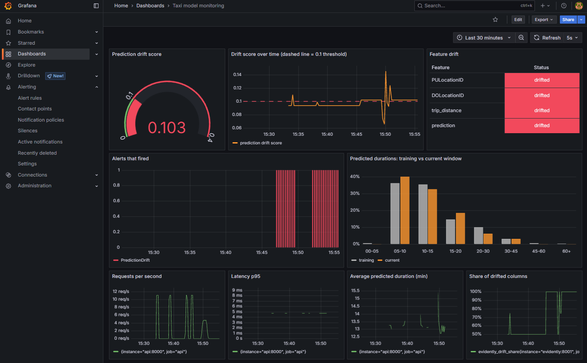
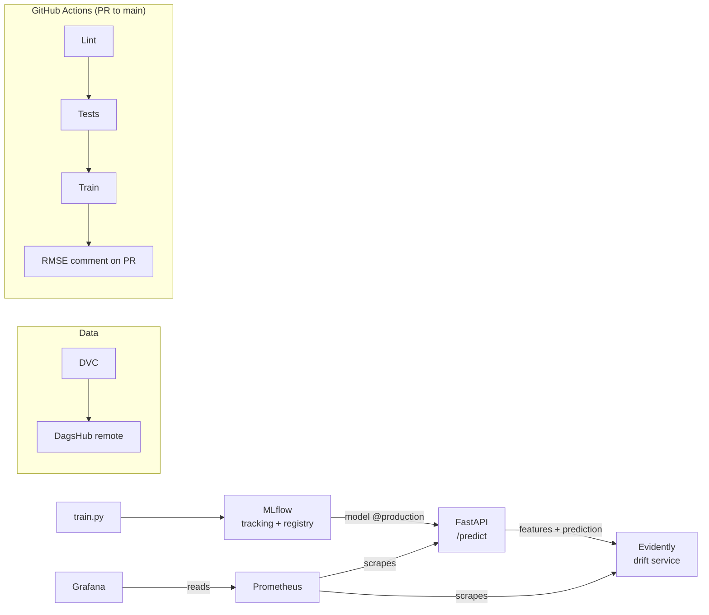

# NYC Taxi Trip Duration: End-to-End MLOps Pipeline

A linear regression model that predicts NYC green taxi trip duration, turned from a notebook into an MLOps workflow: versioned data, tracked and registered models, CI training, a prediction API, and drift monitoring.

>


## Architecture



## Tech stack

| Area | Tools |
|---|---|
| Environment | uv |
| Data versioning | DVC + DagsHub |
| Experiment tracking and registry | MLflow |
| CI | GitHub Actions + CML |
| Serving | FastAPI |
| Monitoring | Evidently, Prometheus, Grafana |
| Containers | Docker Compose |
| Quality | pytest, Ruff + pre-commit |

## Prerequisites

- Docker Desktop, installed and running
- uv 0.13.5 or newer
- Python 3.13

## How to run

Run the steps in this order. The API loads the registered model from MLflow at startup, and the Evidently service needs `data/reference.parquet`, which `train.py` writes.

```bash
uv sync
cp .env.example .env
uv run dvc pull
docker compose up -d mlflow
MLFLOW_TRACKING_URI=http://localhost:5000 uv run python src/train.py
docker compose up --build -d
uv run python -m src.send_data --month 1 --n 500 --sleep 0.2
uv run python -m src.send_data --month 2 --n 500 --sleep 0.2
```

Setting `MLFLOW_TRACKING_URI` on the training command sends the run to the MLflow container.

`train.py` registers every run as a new model version but moves the `production` alias (and rewrites `data/reference.parquet`) only if its RMSE is less than or equal to the current production model's.

To push new data, add your DagsHub credentials:

```bash
uv run dvc remote modify origin --local auth basic
uv run dvc remote modify origin --local user <dagshub-user>
uv run dvc remote modify origin --local password <dagshub-token>
```

The two `send_data` runs replay January trips (same month as the training data) and then February trips, so you can compare the dashboard before and after.

### Services

| Service | URL |
|---|---|
| MLflow | <http://localhost:5000> |
| API docs | <http://localhost:8000/docs> |
| Evidently metrics | <http://localhost:8001/metrics> |
| Prometheus | <http://localhost:9090> |
| Grafana | <http://localhost:3000> (login `admin` / `admin`, local only) |

### Example request

```bash
curl -X POST http://localhost:8000/predict \
  -H "Content-Type: application/json" \
  -d '{"PULocationID": 74, "DOLocationID": 75, "trip_distance": 2.5}'
```

Response (predicted duration in minutes):

```json
{"duration": 12.286250807406354}
```

## Model registry

Every training run is logged in MLflow and registered as a new version. The `production` alias moves only when the new model's RMSE is less than or equal to the current one.


## Monitoring

**API metrics** (`localhost:8000/metrics`):

- `api_prediction_requests_total`: number of predictions
- `api_prediction_latency_seconds`: prediction latency
- `api_predicted_duration_minutes`: distribution of predicted durations

**Drift metrics** (`localhost:8001/metrics`): the API sends each request's features and prediction to the Evidently service, which keeps the latest 200 events and compares them with `data/reference.parquet` (a sample of the training test set with its predictions). Drift is recomputed every 50 events.

- `evidently_drift_share`: share of drifted columns
- `evidently_prediction_drift_score`: drift score of the predictions
- `evidently_column_drift_score`: drift score per column
- `evidently_duration_share`: share of predictions per duration bucket, training vs. current
- `evidently_window_rows`: rows in the current window

Drift uses Wasserstein distance for numeric columns (`trip_distance`, `prediction`) and Jensen–Shannon distance for the location IDs, with a threshold of 0.1.

**Alert:** `PredictionDrift` fires in Prometheus when `evidently_prediction_drift_score` stays above 0.1 for 1 minute.

**Report:** each drift run also saves an HTML report to `reports/drift_report.html`.

## Testing

```bash
uv run pytest                  # unit tests
uv run pytest -m integration   # integration tests, needs the stack running
```

Pre-commit runs `ruff check --fix` and `ruff format` on `src/` and `tests/`:

```bash
uv run pre-commit install
```

## CI

`.github/workflows/train.yaml` runs on every pull request to `main`: lint, unit tests, then it pulls the data with DVC, trains the model, and posts the RMSE as a PR comment with CML. It needs the `DAGSHUB_USER` and `DAGSHUB_TOKEN` repository secrets. The job fails if the RMSE is above 5.5; the gate runs after the PR comment, so the RMSE is still posted.

## Known limits

- Grafana uses the default `admin` / `admin` login, which is fine only for local use.
- The drift window of 200 events is small compared with the number of location IDs, so drift scores for `PULocationID` and `DOLocationID` are noisy.

The starter notebook comes from [mle-monitoring-in-ml](https://github.com/neuefische/mle-monitoring-in-ml/blob/2a805a98f7d6cf2266b291c0984c98f93bc6d9d3/01-train-ml-model.ipynb).
